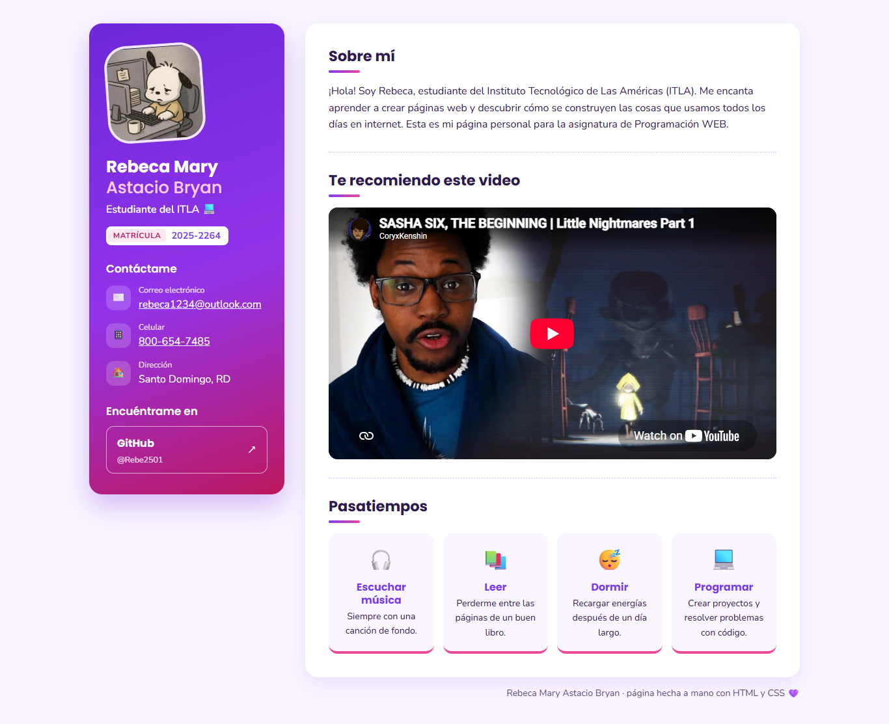
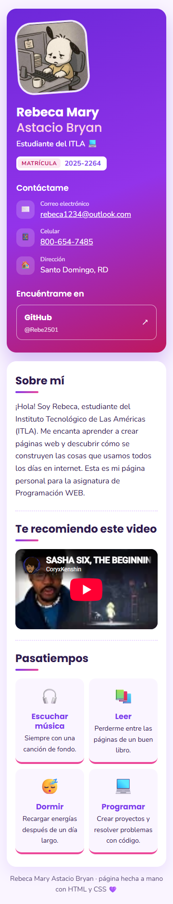

# ¡Hola, soy Rebeca! · Tarea 1 de la web personal

| Autora | Matrícula | Asignatura | Grupo |
|---|---|---|---|
| Rebeca Mary Astacio Bryan | 2025-2264 | Programación WEB (ITLA) | 2026-C-003 |

Mi primera página personal, escrita a mano con HTML y CSS, sin nada de JavaScript.

## Vista previa



En una laptop (1366 px): a la izquierda, una tarjeta morada con mi avatar, mi nombre, mi matrícula,
cómo contactarme y mi GitHub; a la derecha, una hoja blanca con tres temas separados por líneas
punteadas: *Sobre mí*, el video que recomiendo y mis *Pasatiempos* en cuatro fichas.



En un celular (360 px): la tarjeta morada pasa arriba, la hoja blanca queda debajo y las fichas de
pasatiempos se reparten de dos en dos. Nada se sale de la pantalla por los lados.

## Lo que pedía la tarea

| Se pedía… | …y aquí está |
|---|---|
| Foto | Mi avatar de GitHub, inclinado un poquito, arriba de la tarjeta morada |
| Nombre y apellido | Bajo la foto: **Rebeca Mary** y, en rosa claro, **Astacio Bryan** |
| Correo | «Contáctame» → Correo electrónico: rebeca1234@outlook.com (abre el programa de correo) |
| Teléfono | «Contáctame» → Celular: 800-654-7485 (en el celular se puede tocar para llamar) |
| Dirección | «Contáctame» → Dirección: Santo Domingo, RD |
| Hobbies | «Pasatiempos»: escuchar música, leer, dormir y programar |
| Links a redes sociales | «Encuéntrame en» → mi perfil de GitHub, que se abre en otra pestaña |
| Un video de YouTube insertado | «Te recomiendo este video»: un `<iframe>` de YouTube (modo sin cookies) con forma 16:9 |

## Abrirla en tu computadora

Basta con hacer doble clic en `index.html`. Si prefieres un servidorcito local:

```bash
python -m http.server 8000
```

y luego visitar `http://localhost:8000`. La foto, las letras (Poppins y Nunito) y el video llegan
por internet, así que hace falta tener conexión.

## Qué hay en la carpeta

```
Tarea1-PaginaPersonal/
├── index.html          la página
├── css/estilos.css     colores lila y rosa, las dos columnas y el ajuste para celular
└── evidencias/         las dos imágenes de la vista previa
```
