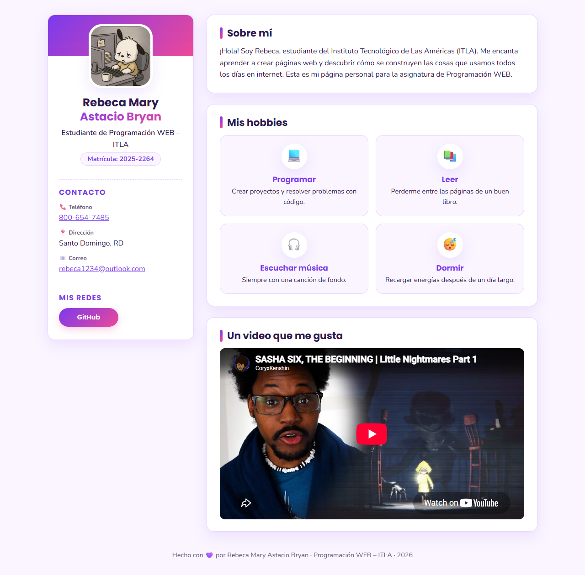
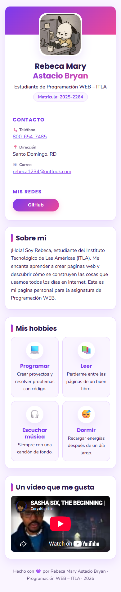

# Tarea 1 – Mi Página WEB Personal

**Estudiante:** Rebeca Mary Astacio Bryan · **Matrícula:** 2025-2264

Programación WEB – ITLA (2026-C-003)

## ¿De qué trata?

Es una página de presentación personal construida solo con **HTML5** y **CSS3**, sin JavaScript.
En computadora se organiza en dos columnas: a la izquierda una tarjeta lateral fija con mi foto,
mis datos y mis redes; a la derecha el contenido principal con una breve presentación, mis hobbies
y un video. En el celular las dos columnas se acomodan una debajo de la otra.

Los colores son lila, violeta y rosa, con las fuentes *Poppins* (títulos) y *Nunito* (texto) de Google Fonts.

## Requisitos de la tarea y dónde se cumplen

| Requisito | Dónde aparece en la página |
|---|---|
| Foto | Arriba de la tarjeta lateral; se toma de mi avatar de GitHub |
| Nombre y apellido | Debajo de la foto: *Rebeca Mary* / *Astacio Bryan* |
| Teléfono | Sección **Contacto**: 800-654-7485 (enlace `tel:` para llamar desde el celular) |
| Dirección | Sección **Contacto**: Santo Domingo, RD |
| Correo electrónico | Sección **Contacto**: rebeca1234@outlook.com (enlace `mailto:`) |
| Hobbies | Panel **Mis hobbies**: Programar, Leer, Escuchar música y Dormir, cada uno en su tarjeta con un emoji |
| Redes sociales | Sección **Mis redes**: botón a mi perfil de GitHub (se abre en otra pestaña) |
| Video de YouTube | Panel **Un video que me gusta**, insertado con un `<iframe>` que mantiene la proporción 16:9 |

Además se usan etiquetas semánticas (`aside`, `main`, `section`, `article`, `footer`) y el diseño
no produce desplazamiento horizontal en pantallas de 390 px.

## Cómo verla

1. Descargar o clonar este repositorio.
2. Abrir el archivo `index.html` con cualquier navegador (doble clic).

También se puede servir la carpeta con un servidor local, por ejemplo:

```bash
python -m http.server 8000
```

y entrar a `http://localhost:8000`. Se necesita conexión a internet para cargar la foto, las fuentes y el video.

## Archivos

```
Tarea1-PaginaPersonal/
├── index.html        → estructura y contenido de la página
├── css/
│   └── estilos.css   → colores, distribución en dos columnas y adaptación a móvil
└── capturas/         → imágenes usadas en este README
```

## Capturas de pantalla



Vista en escritorio (1280 px de ancho): la tarjeta lateral con foto, nombre, matrícula, contacto y redes a la izquierda, y a la derecha el panel "Sobre mí", la cuadrícula de hobbies y el video.



Vista en móvil (390 px de ancho): la tarjeta de perfil queda arriba y los paneles se apilan debajo; los hobbies se muestran en una cuadrícula de 2×2 y el video se ajusta al ancho de la pantalla.
